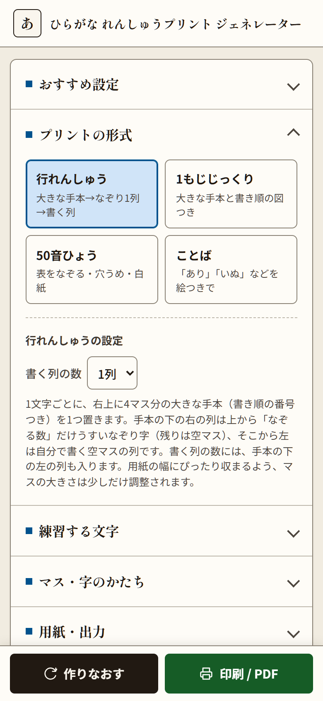
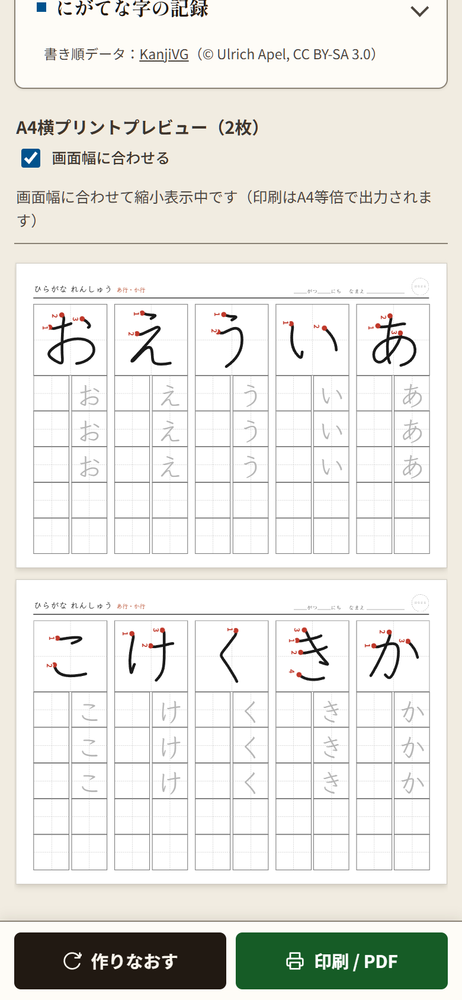

# ひらがな れんしゅうプリント ジェネレーター

**「きょうは あ行 を 練習しよう」が、30秒でA4プリントになります。**

幼稚園児・小学1年生向けに、マスにひらがな・カタカナを書いて練習するプリントをブラウザで作って、そのまま印刷できる無料のWebアプリです。インストールやログインは要りません。年齢を選ぶだけで、マスの大きさや字の形がちょうどよく設定されます。

**▶ 今すぐ使う：<https://hiragana-homework.molkz.com>**


姉妹アプリ「算数 筆算プリント ジェネレーター」「漢字問題ジェネレーター」とデザイン・操作をそろえています。

## もくじ

- [こんな方におすすめ](#こんな方におすすめ)
- [作れるプリント](#作れるプリント)
- [3ステップで印刷](#3ステップで印刷)
- [便利な機能](#便利な機能)
- [スマートフォンでも](#スマートフォンでも)
- [よくある質問](#よくある質問)
- [詳しい使い方（利用ガイド）](docs/USAGE.md)
- [手元で動かす・デプロイ](#手元で動かすデプロイ)
- [ライセンス・クレジット](#ライセンスクレジット)

## こんな方におすすめ

- 市販のドリルでは足りない字、苦手な字だけを**くり返し**練習させたい
- 子どもの**名前の字**を練習するプリントがほしい
- 年少〜小学1年生まで、**成長に合わせてマスの大きさ**を変えたい
- 学校の国語ノートと同じ**縦書き（右から左）**で練習させたい
- 家庭学習や園・学童で、**すぐ印刷できる**教材がほしい

## 作れるプリント

4つの形式があります。用紙はどれも**A4横**、字はすべて国語ノートと同じ**縦書き**で、右から左へ進みます。下はどれも、アプリの「おすすめ設定」を選んだだけで作ったプリントです。

| 行れんしゅう | 1もじじっくり | ことば |
|:---:|:---:|:---:|
| [](docs/screenshots/sheet-line.png) | [](docs/screenshots/sheet-single.png) | [](docs/screenshots/sheet-word.png) |
| 4マス分の大きな手本（書き順の番号つき）を1つ。その下にうすいなぞり字3マス、左は自分で書く空マスの列。あ行の5文字がA4横1枚にぴったり収まります。 | 大きな手本と1画ずつの書き順図、例のことば（絵つき）。はじめて習う字にぴったり。 | 「あり」「いぬ」などのことばを、絵（絵文字）つきの手本の列と、なぞりの列で。 |

| 50音ひょう（穴うめ） | 国語ノート風 |
|:---:|:---:|
| [](docs/screenshots/sheet-chart.png) | [](docs/screenshots/sheet-tate.png) |
| ぜんぶなぞる／穴うめ／白紙の3種類。穴うめはこたえのページつき。 | 中マスで清音をぜんぶ。学校のノートと同じ大きさで練習できます。 |

画像をクリックすると大きく表示されます。

## 3ステップで印刷

1. **[アプリを開く](https://hiragana-homework.molkz.com)**
2. 左の「**おすすめ設定**」で、年齢や目的を選ぶ（例：「年長：あいうえおを1行ずつ」）
3. 右のプレビューを確認して「**印刷 / PDF**」を押す

これだけで1枚目のプリントができます。練習する行（あ行・か行…）、マスの大きさ、字の形などは、そのあと自由に変えられます。設定を変えるとプレビューにすぐ反映されます。

おすすめ設定の一覧：

| えらぶ項目 | できあがるプリント |
|---|---|
| 年少・年中：はじめてのひらがな | 1もじじっくり・特大マス（30mm）・えんぴつ風の字・点線のなぞり字 |
| 年長：あいうえおを1行ずつ | 行れんしゅう・大マス（24mm）・あ行とか行 |
| 小学1年：国語ノート風 | 行れんしゅう・中マス（20mm）・清音ぜんぶ |
| 小学1年：50音ひょうの穴うめ | 50音ひょう・約3割が空欄・こたえつき |
| ことばを書いてみよう | ことば・絵つき・あ行〜さ行 |
| だくおん・ようおんの練習 | が行〜ぱ行、きゃ・しゃ・ちゃ行 |
| カタカナ はじめて | カタカナの1もじじっくり |

各設定項目の意味は [利用ガイド](docs/USAGE.md) で1つずつ説明しています。

## 便利な機能

- **ひらがな／カタカナ**の切りかえ。せいおん・だくおん・はんだくおん・ようおん（きゃ・しゅ…）を行ごとに選べます
- **じぶんで入力**：名前の字や好きなことばでプリントを作れます
- **マスの大きさ**4段階（特大30mm／大24mm／中20mm／小16mm）、**字の大きさ**3段階（マスの6割／7割半／8割半）、なぞる数、十字の点線の有無
- **字のかたち**4種類：教科書体風（Klee One）／UDデジタル教科書体（Windowsのみ）／まるもじ／えんぴつ風（書き順データ）。なぞり字は「うすい字」か「点線」
- あいうえお順／ばらばら、**1〜5セット**をまとめて出力
- なまえ・日付・組・番号・**はなまる欄**、練習する行の表示
- **プリセット**（よく使う設定に名前を付けて保存）と**印刷履歴**（同じ並びをもう一度出せます）
- **にがてな字の記録**：プレビューの手本をクリックして印を付け、記録した字だけでプリントを作れます


*「き」と「け」の手本に印を付けたところ。印は画面だけの表示で、印刷には出ません。*

## スマートフォンでも

スマートフォンやタブレットでも作成できます。プレビューは画面幅に合わせて縮小表示され、「作りなおす」「印刷 / PDF」はいつも画面の下に表示されます。PWAに対応しているので、ホーム画面に追加すると一度開いたあとはオフラインでも使えます。

| 設定画面 | プレビュー |
|:---:|:---:|
|  |  |

## よくある質問

**Q. お金はかかりますか？ 登録は必要ですか？**
A. 無料で、登録やログインもありません。

**Q. 子どもの名前や記録はどこかに送られますか？**
A. 送られません。プリセット・履歴・にがてな字の記録、前回の設定は、使っているブラウザの中（localStorage）にだけ保存されます。別の端末やブラウザとは共有されません。フォントの読み込み時のみ、ブラウザが Google Fonts に接続します。

**Q. 印刷すると大きさがずれます。**
A. 印刷ダイアログで「倍率：100%（実際のサイズ）」「用紙：A4」を選んでください。「ページに合わせる」になっているとマスが小さくなります。詳しくは [利用ガイドの「印刷のコツ」](docs/USAGE.md#印刷のコツ) をご覧ください。

**Q. PDFにして保存したり、送ったりできますか？**
A. 「印刷 / PDF」を押し、印刷先で「PDFに保存」を選ぶとPDFになります。

**Q. 「UDデジタル教科書体」が選べるのに、字が変わりません。**
A. UDデジタル教科書体はWindowsに入っている書体です。Mac・iPhone・Androidなど入っていない環境では、教科書体風（Klee One）で表示されます。

## 手元で動かす・デプロイ

公開版をそのまま使う場合、この節は読まなくてかまいません。

### 手元で動かす

必要なもの：[Node.js](https://nodejs.org/) 20以上

```bash
git clone https://github.com/Satoshi-Hiramatsu/Hiragana-Homework.git
cd Hiragana-Homework
npm install
npm start        # wrangler dev（http://localhost:8787）
```

`public/` は静的ファイルだけで動くので、任意の静的サーバーで配信しても使えます（ES Modules を使うため `file://` で直接開くことはできません）。

### デプロイ（Cloudflare Workers）

```bash
npx wrangler login
npm run deploy
```

独自ドメインを使う場合は `wrangler.jsonc` に `routes` を追加してください。

### ファイル構成

| ファイル | 役割 |
|---|---|
| `public/index.html` | 画面（設定パネル・プレビュー） |
| `public/app.js` | 設定の読み書き、文字・ことばの選択、用紙ヘッダー、プレビュー、プリセット・履歴・にがて記録の画面 |
| `public/sheets.js` | 4形式の割り付けと改ページ（A4横・縦書き。縦書きは CSS の `writing-mode: vertical-rl`） |
| `public/render.js` | マス1つと字（フォント／書き順データ）の描画 |
| `public/kana.js` | 行データ、ことばリスト、ひらがな⇔カタカナ変換 |
| `public/store.js` | localStorage への保存 |
| `public/data/strokes.js` | 書き順データ（自動生成） |
| `tools/build-strokes.mjs` | KanjiVG から書き順データを作り直すスクリプト（`npm run build:strokes`） |
| `.github/readme-showcase.json` | README のスクリーンショットを撮り直すときの画面サイズ・操作手順 |

## ライセンス・クレジット

- 書き順データ：[KanjiVG](https://kanjivg.tagaini.net/)（© Ulrich Apel, [CC BY-SA 3.0](https://creativecommons.org/licenses/by-sa/3.0/)）。`public/data/strokes.js` は KanjiVG から作った派生データのため、同じ CC BY-SA 3.0 が適用されます。
- フォント：Klee One、Zen Maru Gothic、Noto Sans JP、Shippori Mincho（Google Fonts、SIL Open Font License）
- ことば形式の絵は、閲覧している端末の絵文字フォントで表示されます。
