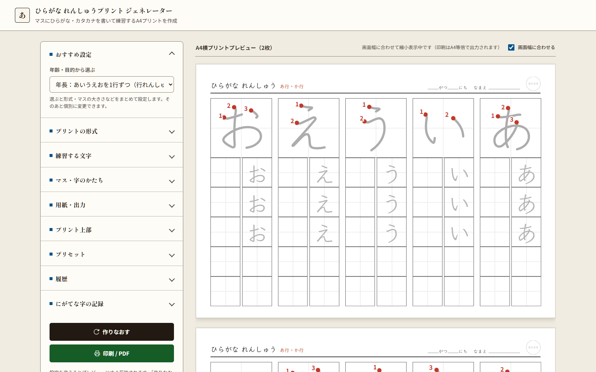
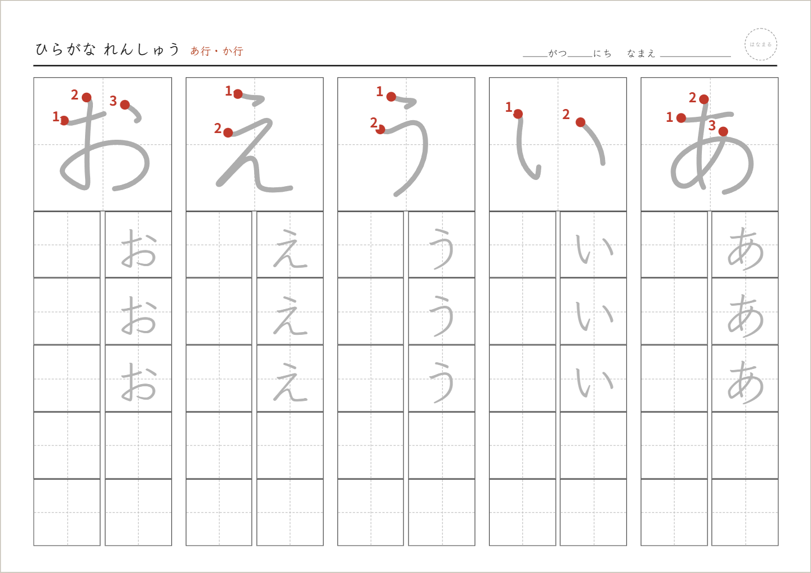
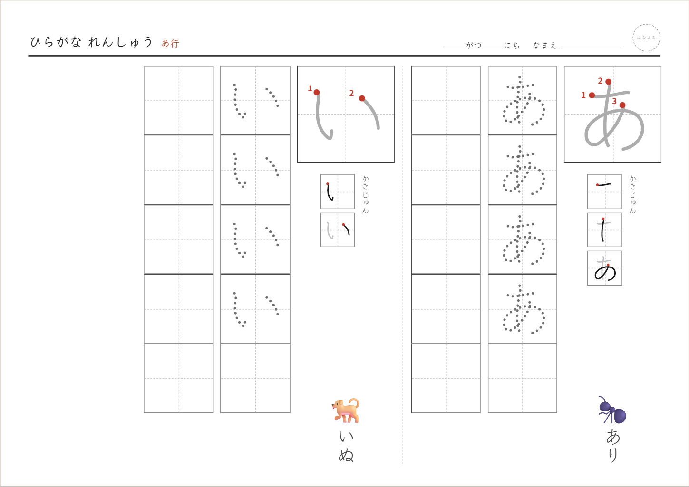
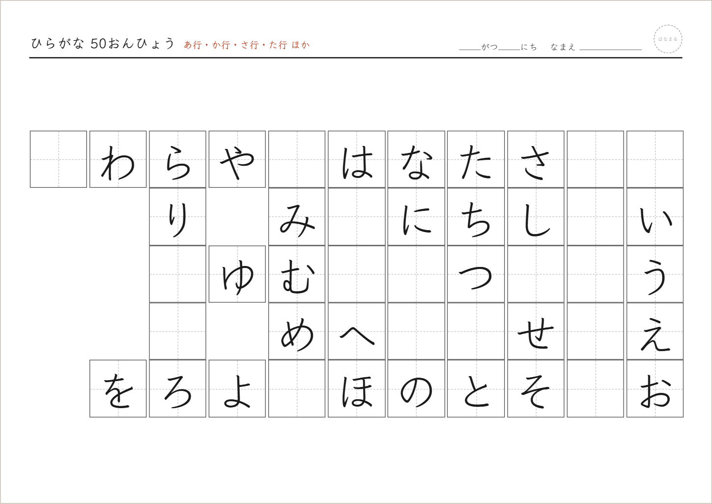
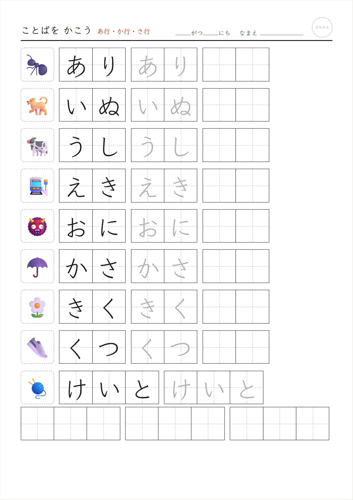
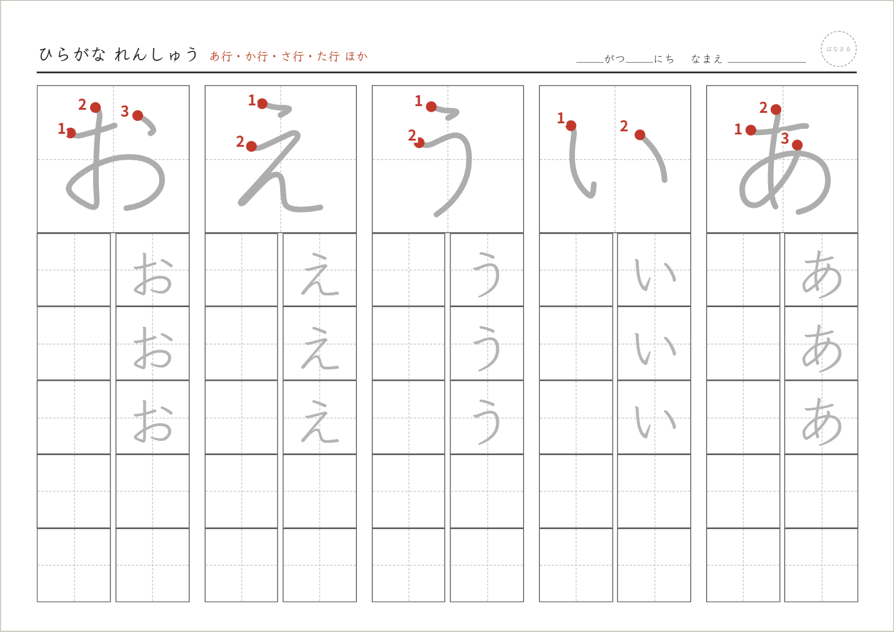
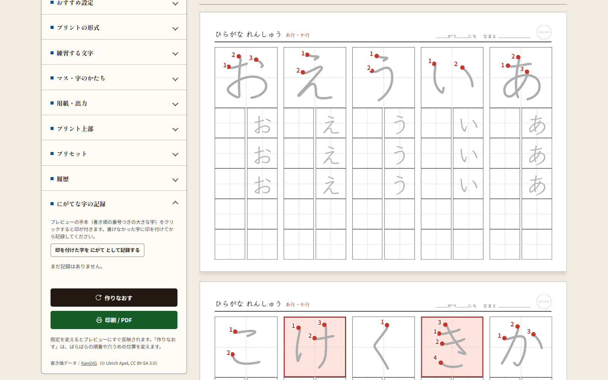

# 利用ガイド

ひらがな れんしゅうプリント ジェネレーターの使い方を、画面の左側の設定カードの順に説明します。はじめての方は、まず [README の「3ステップで印刷」](../README.md#3ステップで印刷) をご覧ください。

公開版：<https://hiragana-homework.molkz.com>

## もくじ

1. [画面の見かた](#1-画面の見かた)
2. [おすすめ設定](#2-おすすめ設定)
3. [プリントの形式](#3-プリントの形式)
4. [練習する文字](#4-練習する文字)
5. [マス・字のかたち](#5-マス字のかたち)
6. [用紙・出力](#6-用紙出力)
7. [プリント上部](#7-プリント上部)
8. [プリセットと履歴](#8-プリセットと履歴)
9. [にがてな字の記録](#9-にがてな字の記録)
10. [印刷のコツ](#印刷のコツ)
11. [困ったときは](#困ったときは)

## 1. 画面の見かた

- **左側**：設定カード。カードの見出しを押すと開きます（一度に開くのは1枚だけ）。
- **右側**：A4プリントのプレビュー。設定を変えるとすぐに作りなおされます。見出しに枚数（例：「A4横プリントプレビュー（2枚）」）が出ます。
- **作りなおす**：「ばらばら」の順番や、50音ひょうの穴うめの位置を変えます。
- **印刷 / PDF**：ブラウザの印刷ダイアログを開きます。

前回の設定はブラウザに自動で保存され、次に開いたときもそのまま使えます。

## 2. おすすめ設定

用紙はどの設定でも**A4横**、字は**縦書き（右から左）**です。

「年齢・目的から選ぶ」で項目を選ぶと、形式・マスの大きさ・字の形などがまとめて設定されます。そのあと、ほかのカードで個別に変更できます。

| えらぶ項目 | 主な設定 |
|---|---|
| 年少・年中：はじめてのひらがな | 1もじじっくり、特大マス（30mm）、えんぴつ風の字、点線のなぞり字、あ行 |
| 年長：あいうえおを1行ずつ | 行れんしゅう、大マス（24mm）、教科書体風、なぞり3つ、あ行・か行 |
| 小学1年：国語ノート風 | 行れんしゅう、中マス（20mm）、せいおんぜんぶ |
| 小学1年：50音ひょうの穴うめ | 50音ひょう、穴うめ（約3割）、こたえのページつき |
| ことばを書いてみよう | ことば、絵つき、中マス、あ行〜さ行 |
| だくおん・ようおんの練習 | が行・ざ行・だ行・ば行・ぱ行、きゃ行・しゃ行・ちゃ行 |
| カタカナ はじめて | カタカナの1もじじっくり、特大マス |

## 3. プリントの形式

4つの形式から選びます。形式によって、下に出る設定項目が変わります。

### 行れんしゅう

1文字ずつ練習します。1文字ごとに、次のように並びます。

1. 右上に、**4マス分（2×2）の大きな手本**を1つ。書き順の番号がいつも全部付きます。手本の字も上からなぞれるよう、うすいグレーです（「書き順つき手本の濃さ」で変えられます）。
2. 手本の下の右の列の上から、ふつうのマスで**うすいなぞり字**（「なぞる数」の数だけ。おすすめは3マス）。残りは空マス。
3. 手本の下の左の列と、そこから左に続く列は、自分で書く**空マス**。

- **書く列の数**（1〜4列、はじめは1列）：空マスの列の数です。手本の下の左の列も1つに数えます。1列なら、1文字が「なぞりの列＋書く列」の2列になり、あ行の5文字がA4横1枚に収まります。

「行からえらぶ」で「あいうえお順」のときは、**1つの行を1ページ**にします（あ行で1枚、か行で1枚…）。マスは5文字で用紙の幅がちょうど埋まる大きさになり、や行・わ・を・ん のような3文字の行は左右の中央に置きます。

それ以外（ばらばら・じぶんで入力・にがてな字）は、文字を各ページに均等に分け、左右に余白が残らないようマスの大きさを選んだ大きさの近くで調整します。

### 1もじじっくり

はじめて習う字向けです。大きな手本には書き順の番号と書きはじめの●がいつも付きます。手本の下に1画ずつの書き順図と、その字ではじまる例のことばが出ます。

- **練習の行数**（1〜3行）：大きな手本の下に並べる、なぞり・空マスの行数です。

### 50音ひょう

選んだ行で50音表を作ります。だくおん・ようおんを選ぶと、別の表として続けて出します。

- **表の出し方**
  - ぜんぶなぞる：すべての字がうすい字で入ります。
  - 穴うめ：ところどころ空欄になります。**空欄の割合**（約2割〜約7割）を選べます。「作りなおす」で空欄の位置が変わります。
  - 白紙：あ段（あ・か・さ…）だけを表示します。
- **こたえのページもつける**：穴うめ・白紙のとき、すべて埋まった表を次のページに付けます。

### ことば

選んだ行の字ではじまることば（「あり」「いぬ」など）を練習します。「なぞる字をだんだんうすくする」がオンのときは、右の列から **絵つきの手本 → なぞり字（濃い）→ なぞり字（うすい）** の3列、オフのときは1列に絵・手本・なぞり・空マスを並べます。

- **絵（絵文字）を表示する**：オフにすると絵の欄が空欄になり、子どもが自分で絵をかけます。絵が用意されていないことばも空欄になります。
- **1つあたりの行数**（1〜3行）：オフのときに使います。増やすと、空マスで書く量が増えます。

## 4. 練習する文字

- **ひらがな／カタカナ**：切りかえると、行の名前も「ア行・カ行…」に変わります。
- **文字のえらびかた**
  - 行からえらぶ：せいおん・だくおん・はんだくおん・ようおんのグループごとに、行のチップをオン／オフします。グループ右の「すべて」「はずす」で一括操作できます。
  - じぶんで入力する：好きな字を入力します（例：子どもの名前）。ことば形式では、1行（または空白区切り）を1つのことばとして扱います。
  - にがてな字：[にがてな字の記録](#9-にがてな字の記録) に保存した字だけで作ります。
- **出す順番**：あいうえお順／ばらばら。

50音ひょう形式では「行からえらぶ」だけが使えます。

## 5. マス・字のかたち

- **マスの大きさ**：特大（30mm）／大（24mm）／中（20mm）／小（16mm）。目安は、年少・年中は特大、年長は大、小学1年は中です。
- **字の大きさ**：小（マスの6割）／ふつう（7割半）／大（8割半）。マスに対する字の大きさで、手本・なぞり字のどちらにも効きます。
- **なぞる数**：手本のあとに並べるなぞり字の数（なし〜6）。行れんしゅうでは、大きな手本の下の列に入れるなぞり字のマスの数です。ことばで「だんだんうすくする」がオンのときは、なぞりの列2つに固定です。
- **字のかたち**
  - 教科書体風（Klee One）
  - UDデジタル教科書体：Windows に入っている書体です。ない環境では Klee One で表示します。
  - まるもじ（Zen Maru Gothic）
  - えんぴつ風：書き順データから線で描いた字です。
- **なぞる字**：うすい字／点線（えんぴつ風の字形）。
- **書き順つき手本の濃さ**：黒（なぞらない）／こいめ／ふつう（上からなぞれる）／うすめ。行れんしゅう・1もじじっくりの大きな手本の字の濃さです。書き順の番号と●は赤のままです。
- **なぞる字をだんだんうすくする**：ことばでは右の列ほど濃く、左の列ほどうすくなります。1もじじっくりでは、上のなぞり字ほど濃くなります。行れんしゅうのなぞり字はいつも同じうすさです。
- **手本に書き順の番号をつける**：番号つきの手本は、えんぴつ風の字形で表示します。行れんしゅう・1もじじっくりの大きな手本には、この設定にかかわらず番号が付きます。
- **書き順の番号に、書きはじめの●を添える**
- **マスに十字の点線を入れる**：字のバランスをとる補助線です。

## 6. 用紙・出力

用紙は**A4横**に決まっています。字はすべて国語ノートと同じ**縦書き**で、右から左へ行が進みます。

- **セット数**（1・2・3・5）：同じ設定のプリントをくり返し出力します。「ばらばら」や穴うめでは、セットごとに中身が変わります。

## 7. プリント上部

- **タイトル**：空欄なら「ひらがな れんしゅう」などが自動で入ります。
- なまえ欄・日付欄・組欄・番号欄・はなまる欄の表示／非表示。
- **練習する行を表示**：タイトルの横に「あ行・か行」のように表示します。

## 8. プリセットと履歴

- **プリセット**：今の設定に名前を付けて保存します（例：「たろう 年長 か行」）。名前が空欄なら内容から自動で付けます。「よびだす」で設定を戻し、「けす」で削除します。
- **履歴**：印刷したプリントを最大20件まで自動で記録します。「表示」を押すと、ばらばらの順番や穴うめの位置まで同じプリントを再現できます。

## 9. にがてな字の記録

1. 子どもが練習したあと、プレビューで**書けなかった字の手本（書き順の番号つきの大きな字）をクリック**します。赤い枠の印が付きます（もう一度クリックで外れます）。印は画面だけの表示で、印刷には出ません。
2. 「にがてな字の記録」を開き、「**印を付けた字を にがて として記録する**」を押します。記録した回数と日時が一覧に残ります。
3. 「練習する文字」→「文字のえらびかた」で「**にがてな字**」を選ぶと、記録した字だけのプリントが作れます。

覚えた字は一覧の「けす」で削除してください。

## 印刷のコツ

1. 「印刷 / PDF」を押します（パソコンでは `Ctrl+P` / `⌘+P` でも同じです）。
2. 印刷ダイアログで次のように設定します。
   - 用紙サイズ：**A4**
   - 倍率：**100%（実際のサイズ）**。「ページに合わせる」だとマスが小さくなります。
   - 余白：**なし**（アプリ側で余白を取っています）
   - 向き：**横**（自動で設定されますが、変わってしまう場合は合わせてください）
3. PDFにしたいときは、プリンターの代わりに「**PDFに保存**」を選びます。

スマートフォンでは、共有メニューの「プリント」からAirPrint・Mopriaなどに対応したプリンターへ印刷できます。

## 困ったときは

| こまったこと | 対処 |
|---|---|
| 「練習する行を1つ以上えらんでください。」と出る | 「練習する文字」で行のチップを1つ以上オンにします。 |
| 「にがてな字がまだ記録されていません。」と出る | 先に [にがてな字の記録](#9-にがてな字の記録) で字を記録するか、えらびかたを「行からえらぶ」に戻します。 |
| ひらがなとカタカナのにがてな字が混ざらない | にがてな字は、選んでいる文字の種類（ひらがな／カタカナ）に合うものだけを使います。 |
| プレビューが横にはみ出る | 画面が狭いと「画面幅に合わせる」が表示されます。オンにすると縮小表示されます（印刷は等倍のまま）。 |
| 絵が表示されない・形が違う | 絵は端末の絵文字フォントで表示されるため、機種によって見た目が変わります。 |
| 前の設定に戻したい | 「履歴」の「表示」か、「プリセット」の「よびだす」を使います。 |

データはすべて、使っているブラウザの中にだけ保存されます。ブラウザの閲覧データを消去すると、プリセット・履歴・にがてな字の記録も消えます。
